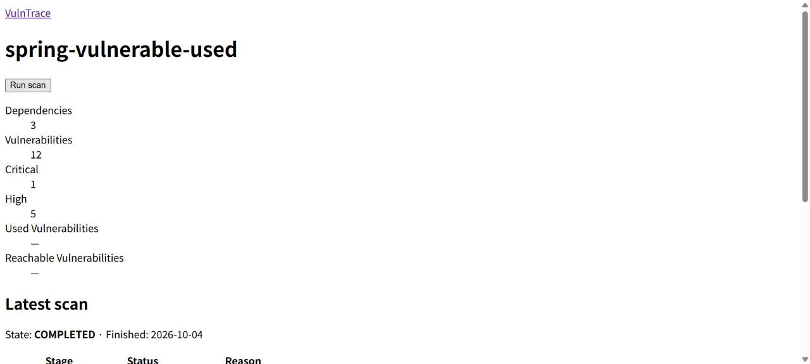
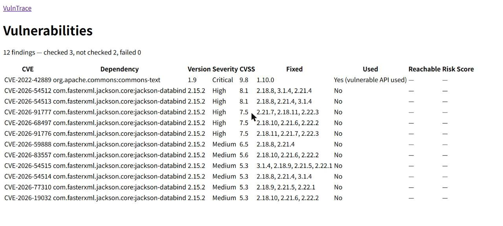
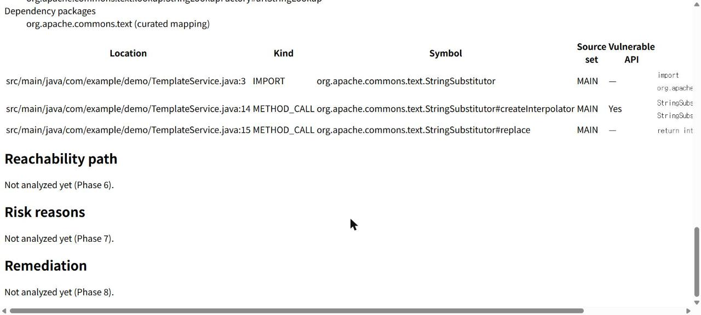

# VulnTrace

취약점 분석 및 우선순위화 플랫폼이며, **TypeScript-first 모노레포**로 구현되어 있습니다.

VulnTrace 구현 언어(TypeScript)와 분석 대상 언어/프레임워크는 독립적입니다. **초기 분석 대상은 Java / Spring Boot / Maven** 프로젝트이며, Java 전용 분석기(`source-analyzer`, `spring-analyzer` 등)는 별도 모듈로 분리되어 있어 이후 다른 언어/프레임워크(예: Node.js, Python 등) 대상 분석기를 추가할 때 core나 API/CLI 오케스트레이션을 다시 만들지 않고 확장할 수 있도록 설계되어 있습니다.

VulnTrace는 단순히 CVE 목록을 나열하는 데 그치지 않습니다. 다음 질문에 답하는 것이 목표입니다.

> 어떤 취약점이 실제로 이 애플리케이션과 관련이 있는가, 어떤 소스 파일이 이를 사용하는가, 애플리케이션 진입점에서 도달 가능한가, 그리고 왜 우선순위를 두어야 하는가?

아래 흐름은 현재 초기 분석 대상인 Java / Spring Boot / Maven 기준입니다.

```text
Java / Spring Boot Repository (초기 분석 대상)
        ↓
Project Detection → Maven Dependency Extraction → SBOM Generation
        ↓
OSV Vulnerability Matching → Java Source Usage Analysis → Spring Endpoint Analysis
        ↓
Reachability Analysis → Risk Scoring
        ↓
React Dashboard / CLI Report
```

전체 제품 스펙, 아키텍처 규칙, 개발 단계는 [`CLAUDE.md`](./CLAUDE.md)(또는 [`CLAUDE_KR.md`](./CLAUDE_KR.md))를, 이 리포지토리가 만들어진 스캐폴딩 계획은 [`.claude/docs/init_plan.md`](./.claude/docs/init_plan.md)를 참고하세요.

> **현재 상태: Phase 4까지 구현 완료 (MVP 1 달성)** — Phase 1(Maven 의존성 분석), Phase 2(SBOM + OSV 취약점 매칭), Phase 3(CLI 리포트 + React 대시보드, DB 연동), Phase 4(Java 소스 사용 분석)가 구현되어 있습니다. Spring 엔드포인트/도달 가능성 분석, 위험도 산정(Phase 5~7)은 아직 스텁(`NotImplementedError`) 상태이며, 대시보드의 Reachable/Risk Score 열은 그 Phase들이 끝나기 전까지 값을 지어내지 않고 `—`로 표시됩니다. 실제 동작 예시는 아래 [현재 구현 상태](#현재-구현-상태-phase-4까지)를 참고하세요.
>
> **OSV 조회와 네트워크 전송**: `vulntrace vulnerabilities`/`scan`(기본 동작) 또는 API의 `POST /api/projects/:id/scans`(`checkVulnerabilities` 기본값 `true`)는 확정된 의존성의 패키지 좌표(`groupId:artifactId@version`, purl)를 `https://api.osv.dev`로 전송해 취약점을 조회합니다. 소스 코드나 파일 내용은 전송하지 않습니다. CLI에서는 `--skip-vulnerabilities`로, API에서는 `checkVulnerabilities: false`로 끌 수 있습니다.

---

## 현재 구현 상태 (Phase 4까지)

| Phase | 내용 | 상태 |
|---|---|---|
| 0 | TypeScript 모노레포 스캐폴딩 | ✅ 완료 |
| 1 | Maven 의존성 분석 (pom.xml 파싱, `mvn dependency:tree`, purl) | ✅ 완료 |
| 2 | CycloneDX SBOM + OSV 취약점 매칭 | ✅ 완료 |
| 3 | CLI 리포트 + React 대시보드 (PostgreSQL 연동) | ✅ 완료 |
| 4 | Java 소스 사용 분석 (import / 객체 생성 / 메서드 호출 증거, 취약 API 사용 여부) | ✅ 완료 — MVP 1 |
| (MVP 1 이후) | GitHub 저장소 입력 | ⏳ 다음 단계 |
| 5~8 | Spring 엔드포인트 / 도달 가능성 / 위험도 / 조치 안내 | 미착수 |

아래 결과는 `fixtures/spring-vulnerable-used`를 실제로 스캔해서 얻은 것입니다(2026-10-17, 실제 OSV 조회, `--allow-maven` 없이 실행). OSV 데이터는 계속 갱신되므로 취약점 개수는 실행 시점에 따라 달라질 수 있습니다. 픽스처의 기준 취약점인 `commons-text 1.9` → CVE-2022-42889(Critical, fixed `1.10.0`)는 항상 검출되어야 합니다.

### CLI

```text
$ node apps/cli/dist/index.js scan fixtures/spring-vulnerable-used
Project: spring-vulnerable-used
State:   COMPLETED

Dependencies:      3   (2 unresolved — not checked)
Vulnerabilities:   12
Critical:          1
High:              5
Used by source:    1

ID              Severity  CVSS  Dependency                                          Used  Vuln API  Fixed
CVE-2022-42889  CRITICAL  9.8   org.apache.commons:commons-text@1.9                 yes   used      1.10.0
  (GHSA-599f-7c49-w659)
CVE-2026-54512  HIGH      8.1   com.fasterxml.jackson.core:jackson-databind@2.15.2  no    no info   2.18.8, 3.1.4, 2.21.4
...
```

`report`는 마지막에 사용 증거(파일:라인)를 출력합니다.

```text
$ node apps/cli/dist/index.js report fixtures/spring-vulnerable-used
...
Source usage: 3 Java files analyzed (3 main, 0 test)

CVE-2022-42889  org.apache.commons:commons-text@1.9  used, vulnerable API used
  packages: org.apache.commons.text (curated mapping)
  vulnerable APIs checked: org.apache.commons.text.StringSubstitutor#createInterpolator, ...
  src/main/java/com/example/demo/TemplateService.java:3   IMPORT       org.apache.commons.text.StringSubstitutor
  src/main/java/com/example/demo/TemplateService.java:14  METHOD_CALL  org.apache.commons.text.StringSubstitutor#createInterpolator  [vulnerable API]
  src/main/java/com/example/demo/TemplateService.java:15  METHOD_CALL  org.apache.commons.text.StringSubstitutor#replace
...
```

- `scan`은 요약 블록과 취약점 표를 출력합니다. `report`는 요약, 의존성, 취약점, 미확정 의존성, 소스 사용 증거를 모두 담은 전체 텍스트 리포트를 출력하고, `--json`을 주면 JSON으로 출력합니다.
- `Used`는 `src/main/java`에서 의존성 패키지를 쓰는 곳(import, 패키지 경로 참조, `new`, 메서드 호출)이 하나라도 있으면 `yes`입니다. `src/test/java` 사용은 증거로 남기되 `used` 판정에는 넣지 않습니다.
- `Vuln API`는 `used` / `not detected` / `no info` 중 하나입니다. 정적 분석으로 호출을 못 찾았다고 안 쓴다고 단정하지 않기 때문에 `not used` 대신 `not detected`라고 씁니다. 취약 API 목록은 OSV에 함수 단위 정보가 없어 `packages/source-analyzer/src/usage/vulnerableApis.ts`에 직접 정리했고, 목록에 없는 취약점은 `no info`입니다.
- 버전을 부모 POM이 관리하는 의존성(예: `spring-boot-starter-web`)은 Maven 실행 없이는 버전을 알 수 없습니다. 이런 의존성은 숨기지 않고 `unresolved — not checked`로 따로 셉니다.
- 취약점은 심각도와 CVSS 순으로 정렬됩니다. 정렬은 `packages/core`의 `compareFindings`가 맡으며, CLI와 API가 같은 함수를 씁니다.

### 웹 대시보드

**Project Dashboard**: 웹에서 "Run scan"을 누르면 API가 CLI와 같은 `ScanOrchestrator`로 스캔하고 결과를 PostgreSQL에 저장합니다. 화면에는 Dependencies / Vulnerabilities / Critical / High 집계, 단계별 상태(PROJECT_DETECTION → … → RISK)와 SKIPPED/FAILED 사유, vulnerability coverage, 미확정 의존성 목록이 나옵니다. Used Vulnerabilities는 소스에서 사용하는 취약점 수이고(소스 분석 전 스캔이면 `—`), Reachable은 Phase 6 전까지 `—`로 표시됩니다.



**Vulnerability List**: CVE / Dependency / Version / Severity / CVSS / Fixed / Used / Reachable / Risk Score 열이 있고, 정렬은 API가 해서 보냅니다. Used 열은 `Yes (vulnerable API used)`처럼 취약 API 판정을 함께 보여 줍니다. 행을 누르면 상세 화면으로 이동합니다.



**Vulnerability Detail — Usage evidence**: 사용 여부, main/test 사용 수, 취약 API 판정, 검사한 취약 API 목록, 의존성 패키지 매핑 근거(`curated mapping` / `assumed from groupId`), 사용 위치 표(파일:라인, 종류, 심볼, Source set, 취약 API 여부, 코드 조각)가 나옵니다. 데이터는 `GET /api/findings/:findingId/usages`에서 가져옵니다.



브라우저 end-to-end 확인에서 함께 동작을 확인한 기능:

- **Project List**: 프로젝트마다 최근 스캔 상태, 의존성 수, 취약점 수가 나옵니다. 스캔이 끝나면 다시 불러와 갱신됩니다.
- **프로젝트 등록 에러 표시**: 없는 경로를 등록하면 서버 응답이 그대로 표시됩니다(`PATH_NOT_FOUND: path does not exist or is not a directory: ...`).
- **Vulnerability Detail**: 다음 정보가 나옵니다.
  - CVE 메타데이터: OSV id(GHSA), CVE 별칭, 요약, 심각도와 그 출처(`CVSS_V3`), CVSS 벡터
  - 의존성: purl, 현재 버전, fixed 버전
  - 근거: provider(OSV), 조회 시각, 영향 버전, `affectedRanges` 원문
  - references
  - Reachability / Risk / Remediation 섹션은 "Not analyzed yet (Phase N)"으로 표시됩니다.

### 알려진 한계 (Phase 4 기준)

소스 사용 분석 (Stage A, TypeScript 경량 파서):

- 반환값 체인(`a().b()`)의 수신 타입, 상속받은 메서드, 리플렉션, `Type.FIELD.m()` 형태의 호출은 추적하지 않습니다. 그래서 취약 API가 `not detected`로 나올 수 있습니다.
- `var`는 `var x = new T(...)`만 해석하고, 변수 이름은 파일 단위로 단순화해서 봅니다.
- artifact → Java 패키지 매핑은 직접 정리한 매핑표가 우선이고, 없으면 `groupId`를 패키지 접두사로 추정합니다(결과에 `assumed from groupId`로 표시). 같은 groupId를 쓰는 다른 artifact와 구분하지 못할 수 있습니다.
- 취약 API 목록은 직접 정리한 것이라 현재는 CVE-2022-42889(commons-text)만 들어 있습니다.

그 밖에:

- 대시보드의 "Run scan"은 기본 옵션(Maven 미실행, OSV 조회)으로만 스캔합니다. 옵션을 고르는 UI는 아직 없습니다.
- 스캔은 요청 안에서 동기로 실행됩니다. 스캔 결과 저장이 하나의 트랜잭션으로 묶여 있지 않고, 프로젝트 목록 집계는 프로젝트마다 쿼리를 따로 보냅니다(N+1).
- 인증/권한, 페이지네이션은 없습니다.

---

## 기술 스택

| 영역 | 기술 |
|---|---|
| Frontend | React, TypeScript, Vite, React Router, TanStack Query |
| Backend | Node.js, TypeScript, Fastify |
| Database | PostgreSQL, Prisma |
| CLI | TypeScript, Commander.js |
| 취약점 분석 | OSV API, CycloneDX(SBOM), Maven, Java 소스 분석기 |
| 분석 대상 | Java / Spring Boot / Maven |
| 인프라 | Docker, Docker Compose |
| 모노레포 | pnpm workspace |

> VulnTrace의 구현 언어(TypeScript)와 분석 대상 언어(Java)는 독립적입니다. Redux/Zustand, Redis, Kafka, 큐, 마이크로서비스 등은 구체적인 필요가 생기기 전까지 도입하지 않습니다.

---

## 프로젝트 구조

```text
apps/
  web/    React + TypeScript + Vite 대시보드 (TanStack Query, React Router)
  api/    Node.js + TypeScript + Fastify HTTP API
  cli/    TypeScript CLI (Commander.js) — `vulntrace scan|dependencies|vulnerabilities|report`

packages/
  shared/               도메인 타입, Result/Error 모델 (의존성 없음)
  dependency-analyzer/  Maven pom.xml + dependency-tree 분석 (초기 대상: Java/Maven)
  sbom/                 CycloneDX SBOM 생성
  vulnerability/        OSV 취약점 provider
  source-analyzer/      Java import/사용처 분석 (초기 대상: Java)
  spring-analyzer/      Spring 엔드포인트 탐지 (초기 대상: Spring Boot)
  reachability/         엔드포인트 → 취약 API 사용처 호출 경로 분석
  risk/                 위험도 점수 산정
  core/                 ScanOrchestrator — 위 단계들을 조립, api와 cli가 공통으로 사용
                        (언어/프레임워크별 분석기는 core의 인터페이스를 구현하는 형태로 추가될 예정)

prisma/       PostgreSQL 스키마 (projects, scans, dependencies, vulnerabilities, evidence 테이블)
fixtures/     정적 분석 대상으로만 쓰이는 샘플 Maven/Spring Boot 프로젝트 (빌드/실행하지 않음)
```

의존 방향: `web → shared`, `api/cli → core → (dependency-analyzer, sbom, vulnerability, source-analyzer, spring-analyzer, reachability, risk) → shared`.

---

## 요구 사항

- Node.js **>= 20**
- [pnpm](https://pnpm.io/) 9.x (이 리포지토리는 `packageManager: pnpm@9.15.0`으로 고정되어 있습니다. pnpm이 전역 설치되어 있지 않다면 `corepack enable` 또는 `npx pnpm@9.15.0 <명령어>`로 실행하세요)
- Docker (로컬에서 PostgreSQL을 띄우고 싶은 경우에만 필요)

## 설치

```bash
pnpm install
cp .env.example .env   # 필요하면 DATABASE_URL / API_HOST / API_PORT 값을 수정
```

## 자주 쓰는 명령어

루트(pnpm 워크스페이스)에서 실행합니다.

```bash
pnpm typecheck        # 전체 패키지 tsc -b (strict)
pnpm test             # vitest run
pnpm build            # 모든 패키지/앱 빌드
pnpm lint             # eslint .
pnpm format           # prettier --write .
```

### API

```bash
pnpm dev:api                          # tsx watch — http://127.0.0.1:3000
curl http://127.0.0.1:3000/api/health # → {"status":"ok"}
```

### 웹 대시보드

웹은 Fastify API(DB 포함)를 통해서만 데이터를 보므로, DB와 API를 먼저 띄워야 합니다.

```bash
pnpm db:up                          # docker compose up -d postgres
npx prisma migrate dev              # 최초 1회 / 스키마 변경 시
pnpm dev:api                        # http://127.0.0.1:3000
pnpm dev:web                        # http://localhost:5173 (vite, /api → API_PORT(기본 3000)로 proxy)
```

3000번 포트를 다른 프로그램(예: Grafana)이 쓰고 있으면, API와 웹을 같은 `API_PORT`로 띄우세요.

```bash
API_PORT=3001 pnpm dev:api
API_PORT=3001 pnpm dev:web
```

`http://127.0.0.1:5173`에서 프로젝트 이름/경로(예: `fixtures/spring-vulnerable-used`)를 등록하고, 대시보드에서 "Run scan" 버튼으로 스캔을 실행하면 같은 `ScanOrchestrator`가 CLI와 동일하게 동작합니다. 빌드만 하려면:

```bash
pnpm --filter @vulntrace/web build
```

### CLI

```bash
pnpm --filter @vulntrace/cli dev -- --help
pnpm --filter @vulntrace/cli dev -- scan ./fixtures/spring-vulnerable-reachable
pnpm --filter @vulntrace/cli dev -- vulnerabilities ./fixtures/spring-vulnerable-used
pnpm --filter @vulntrace/cli dev -- scan ./fixtures/spring-vulnerable-used --skip-vulnerabilities --sbom ./bom.json
```

주요 옵션: `--allow-maven`(전이 의존성 해석을 위해 `mvn dependency:tree` 실행 허용, 기본 비활성), `--skip-vulnerabilities`(OSV 조회를 끔, 네트워크 전송 없음), `--sbom <file>`(생성된 CycloneDX SBOM을 JSON 파일로 저장).

또는 한 번 빌드한 뒤 컴파일된 바이너리를 직접 실행할 수 있습니다.

```bash
pnpm --filter @vulntrace/cli build
node apps/cli/dist/index.js --help
```

`vulntrace` 명령으로 바로 쓰려면 한 번만 전역 링크를 걸어 두세요. 링크는 `apps/cli/dist`를 가리키므로, CLI 소스를 고친 뒤에는 다시 빌드해야 반영됩니다.

```bash
pnpm --filter @vulntrace/cli build
cd apps/cli && pnpm link --global      # 해제: pnpm uninstall --global @vulntrace/cli
vulntrace scan fixtures/spring-vulnerable-used
```

### 데이터베이스 (PostgreSQL + Prisma)

```bash
pnpm db:up              # docker compose up -d postgres
pnpm prisma:validate    # prisma/schema.prisma 검증 (DATABASE_URL 필요, .env 참고)
pnpm prisma:generate    # Prisma client 생성
```

## 픽스처

`fixtures/`에는 정적 분석 입력으로만 사용되는 최소 구성의 Spring Boot/Maven 프로젝트 4개가 있습니다 (스캐너의 신뢰할 수 없는 입력 정책에 따라 소스는 컴파일/실행하지 않습니다).

| 픽스처 | 기대 결과 |
|---|---|
| `spring-safe-app` | 취약한 의존성 없음 |
| `spring-vulnerable-unused` | 취약 의존성은 있으나 미사용 → `used=false, reachable=false` |
| `spring-vulnerable-used` | 소스에서 사용되나 엔드포인트로 연결되지 않음 → `used=true, reachable=false` |
| `spring-vulnerable-reachable` | 사용되고 엔드포인트에서 도달 가능 → `used=true, reachable=true` |
