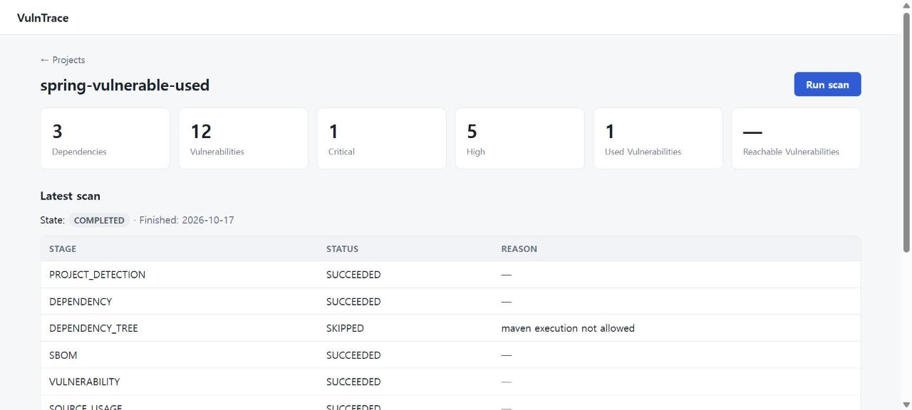
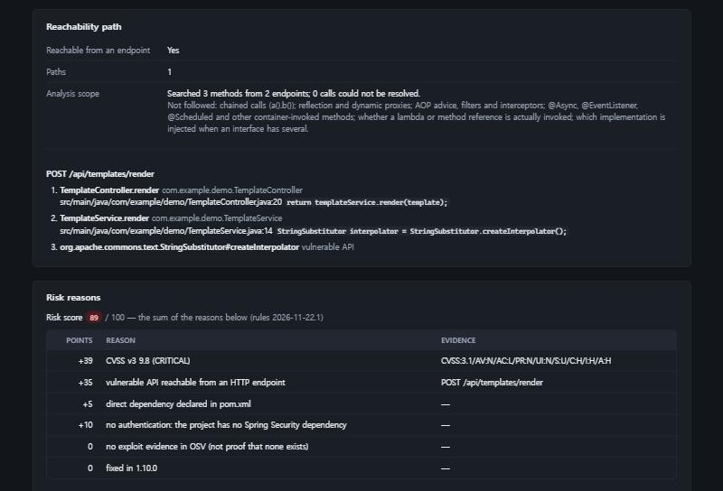
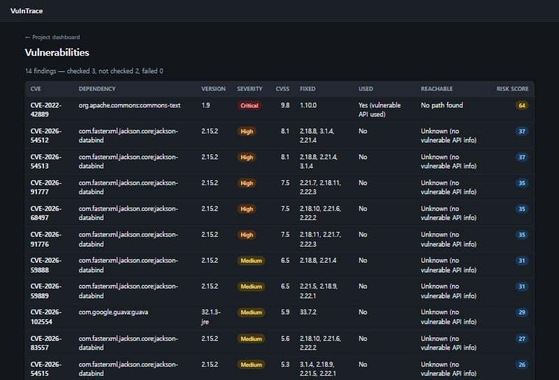
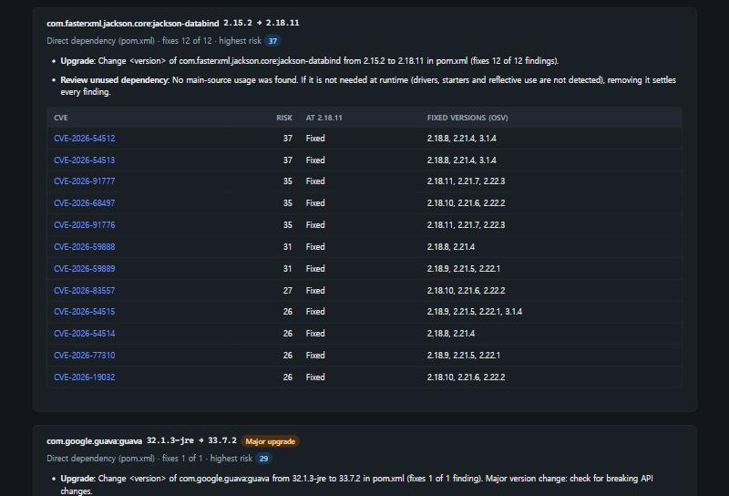
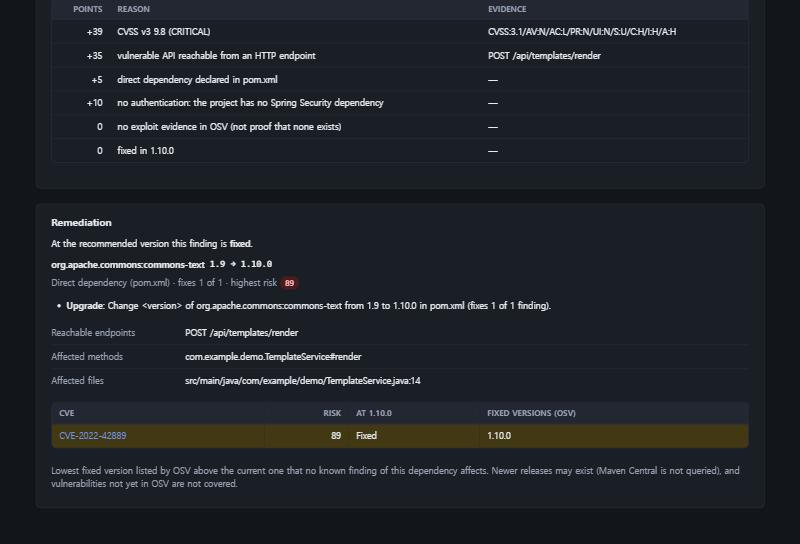
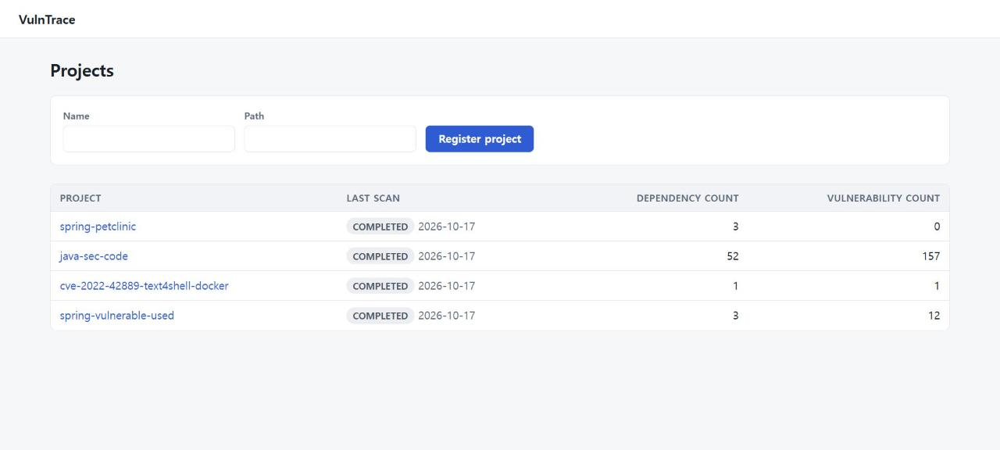
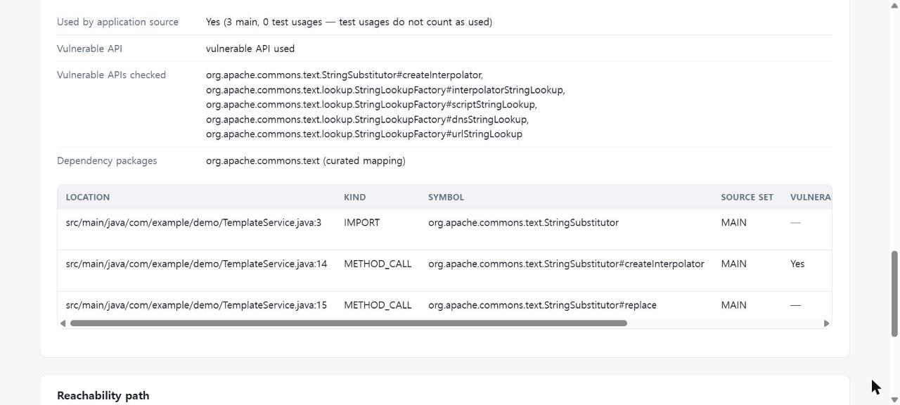

# VulnTrace

취약점 분석 및 우선순위화 플랫폼이며, **TypeScript-first 모노레포**로 구현되어 있습니다.

VulnTrace 구현 언어(TypeScript)와 분석 대상 언어/프레임워크는 독립적입니다. **초기 분석 대상은 Java / Spring Boot / Maven** 프로젝트이며, Java 전용 분석기(`source-analyzer`, `spring-analyzer` 등)는 별도 모듈로 분리되어 있어 이후 다른 언어/프레임워크(예: Node.js, Python 등) 대상 분석기를 추가할 때 core나 API/CLI 오케스트레이션을 다시 만들지 않고 확장할 수 있도록 설계되어 있습니다.

VulnTrace는 단순히 CVE 목록을 나열하는 데 그치지 않습니다. 다음 질문에 답하는 것이 목표입니다.

> 어떤 취약점이 실제로 이 애플리케이션과 관련이 있는가, 어떤 소스 파일이 이를 사용하는가, 애플리케이션 진입점에서 도달 가능한가, 그리고 왜 우선순위를 두어야 하는가?

아래 흐름은 현재 초기 분석 대상인 Java / Spring Boot / Maven 기준입니다.

```text
Java / Spring Boot Repository (초기 분석 대상)
        ↓
Project Detection → Maven Dependency Extraction → SBOM Generation
        ↓
OSV Vulnerability Matching → Java Source Usage Analysis → Spring Endpoint Analysis
        ↓
Reachability Analysis → Risk Scoring
        ↓
React Dashboard / CLI Report
```

전체 제품 스펙, 아키텍처 규칙, 개발 단계는 [`CLAUDE.md`](./CLAUDE.md)(또는 [`CLAUDE_KR.md`](./CLAUDE_KR.md))를, 이 리포지토리가 만들어진 스캐폴딩 계획은 [`.claude/docs/init_plan.md`](./.claude/docs/init_plan.md)를 참고하세요.

> **현재 상태: 로드맵 Phase 0~8 모두 구현 (MVP 1 달성) + GitHub 저장소 입력** — Phase 1(Maven 의존성 분석), Phase 2(SBOM + OSV 취약점 매칭), Phase 3(CLI 리포트 + React 대시보드, DB 연동), Phase 4(Java 소스 사용 분석), Phase 5(Spring 엔드포인트 분석), Phase 6(도달 가능성 분석), Phase 7(위험도 우선순위), Phase 8(조치 안내)이 구현되어 있고, 로컬 경로뿐 아니라 공개 GitHub 저장소 URL로도 스캔할 수 있습니다. 실제 화면은 아래 [시연](#시연-phase-68)을, 단계별 동작은 [현재 구현 상태](#현재-구현-상태-phase-8까지)를 참고하세요.
>
> **OSV 조회와 네트워크 전송**: `vulntrace vulnerabilities`/`scan`(기본 동작) 또는 API의 `POST /api/projects/:id/scans`(`checkVulnerabilities` 기본값 `true`)는 확정된 의존성의 패키지 좌표(`groupId:artifactId@version`, purl)를 `https://api.osv.dev`로 전송해 취약점을 조회합니다. 소스 코드나 파일 내용은 전송하지 않습니다. CLI에서는 `--skip-vulnerabilities`로, API에서는 `checkVulnerabilities: false`로 끌 수 있습니다.

---

## 시연 (Phase 6~8)

`fixtures/spring-vulnerable-reachable`을 CLI와 웹 대시보드로 스캔한 결과입니다(2026-11-22, 실제 OSV 조회, Maven 미실행). 이 픽스처는 `POST /api/templates/render` → `TemplateController.render` → `TemplateService.render` → `StringSubstitutor.createInterpolator()`(CVE-2022-42889, Text4Shell)로 이어지도록 만든 예제입니다.

VulnTrace는 "취약한 라이브러리가 있다"에서 멈추지 않고, **어떤 HTTP 요청이 어떤 코드를 거쳐 취약한 호출에 닿는지**, **그래서 얼마나 먼저 고쳐야 하는지**, **어느 버전으로 올리면 해결되는지**를 근거와 함께 보여 줍니다.

```text
$ node apps/cli/dist/index.js report fixtures/spring-vulnerable-reachable
...
Used by source:    1
Endpoints:         2
Reachable:         1

ID              Risk  Severity  CVSS  Dependency                           Used  Vuln API  Reachable  Fixed
CVE-2022-42889  89    CRITICAL  9.8   org.apache.commons:commons-text@1.9  yes   used      yes        1.10.0
...
Reachability: call graph of 8 methods, 1 calls, 0 unresolved

CVE-2022-42889  org.apache.commons:commons-text@1.9  reachable, 1 path(s)
  POST /api/templates/render
    -> com.example.demo.TemplateController#render
         src/main/java/com/example/demo/TemplateController.java:20  return templateService.render(template);
    -> com.example.demo.TemplateService#render
         src/main/java/com/example/demo/TemplateService.java:14  StringSubstitutor interpolator = StringSubstitutor.createInterpolator();
    => org.apache.commons.text.StringSubstitutor#createInterpolator

Risk: 1 findings scored (rules 2026-11-22.1), highest first

CVE-2022-42889  org.apache.commons:commons-text@1.9  risk 89
   +39  CVSS v3 9.8 (CRITICAL)  [CVSS:3.1/AV:N/AC:L/PR:N/UI:N/S:U/C:H/I:H/A:H]
   +35  vulnerable API reachable from an HTTP endpoint  [POST /api/templates/render]
    +5  direct dependency declared in pom.xml
   +10  no authentication: the project has no Spring Security dependency
     0  no exploit evidence in OSV (not proof that none exists)
     0  fixed in 1.10.0
```

**대시보드** — "Run scan" 한 번으로 REACHABILITY와 RISK 단계까지 실행되고, Reachable Vulnerabilities가 집계됩니다.



**상세 화면 — 도달 경로와 위험 근거** — 엔드포인트에서 취약한 호출까지의 경로를 단계별 파일:라인과 소스 한 줄로 보여 주고, 위험 점수 89가 어떤 근거의 합인지 표로 보여 줍니다. 분석이 따라가지 못하는 범위(체인 호출, 리플렉션, AOP 등)도 함께 표시합니다.



**위험도 순 정렬** — `fixtures/spring-vulnerable-used`(Finding 14개)에서는 취약 API를 실제로 호출하는 commons-text(64)가 맨 위에, 코드에서 쓰지 않는 jackson-databind HIGH(37, 35…)가 그 아래에 옵니다. 심각도만으로 정렬했다면 HIGH 13개 사이에 묻혔을 차이입니다.



**조치 안내 (Phase 8)** — `fix-plan`은 취약한 의존성마다 "어느 버전으로 올리면 알려진 Finding이 몇 개 해결되는지"를 한 줄로 알려 줍니다. 권장 버전은 OSV에 수정 버전으로 적힌 버전 중, 그 의존성의 **모든 Finding의 영향 범위를 벗어나는 가장 낮은 버전**입니다(Maven 버전 규칙으로 비교).

```text
$ node apps/cli/dist/index.js fix-plan fixtures/spring-vulnerable-reachable
Fix plan: 1 dependency, 1 finding

1. org.apache.commons:commons-text  1.9 → 1.10.0  (direct, pom.xml)
   fixes 1 of 1  ·  highest risk 89
   UPGRADE_DIRECT: Change <version> of org.apache.commons:commons-text from 1.9 to 1.10.0 in pom.xml (fixes 1 of 1 finding).
   reachable from: POST /api/templates/render
   affected methods: com.example.demo.TemplateService#render
   affected files: src/main/java/com/example/demo/TemplateService.java:14
     CVE-2022-42889  risk 89  fixed  (fixed in 1.10.0)

Basis: Lowest fixed version listed by OSV above the current one that no known finding of this dependency affects. ...
```

**Fix plan 화면** — 대시보드의 "View fix plan →"에서 의존성별 계획을 위험도 순으로 봅니다. 아래는 `spring-vulnerable-used`의 jackson-databind로, 수정 버전이 2.18 / 2.21 / 2.22 / 3.1 계열에 흩어진 CVE 12개가 `2.15.2 → 2.18.11` 한 번으로 모두 해결된다는 것과, 코드에서 쓰지 않으니 제거도 검토하라는 안내가 나옵니다. guava처럼 메이저 버전이 바뀌면 경고가 붙습니다.



**상세 화면 — Remediation** — CLAUDE.md §7 Phase 8이 요구하는 항목(현재·수정 버전, 영향 파일·메서드, 도달 엔드포인트, 권장 조치)을 한 섹션에 모으고, 이 Finding이 권장 버전에서 해결되는지 표시합니다.



---

## 현재 구현 상태 (Phase 8까지)

| Phase | 내용 | 상태 |
|---|---|---|
| 0 | TypeScript 모노레포 스캐폴딩 | ✅ 완료 |
| 1 | Maven 의존성 분석 (pom.xml 파싱, `mvn dependency:tree`, purl) | ✅ 완료 |
| 2 | CycloneDX SBOM + OSV 취약점 매칭 | ✅ 완료 |
| 3 | CLI 리포트 + React 대시보드 (PostgreSQL 연동) | ✅ 완료 |
| 4 | Java 소스 사용 분석 (import / 객체 생성 / 메서드 호출 증거, 취약 API 사용 여부) | ✅ 완료 — MVP 1 |
| (MVP 1 이후) | GitHub 저장소 입력 (공개 저장소 URL → 얕은 clone → 분석 → 삭제, commit SHA 기록) | ✅ 완료 |
| 5 | Spring 엔드포인트 분석 (`@RestController`/`@Controller` + `@*Mapping` → HTTP 메서드, 경로, 컨트롤러 메서드, 어노테이션 증거) | ✅ 완료 |
| 6 | 도달 가능성 분석 (엔드포인트 → 호출 그래프 → 취약 API 호출 경로, 단계별 호출 위치 증거) | ✅ 완료 |
| 7 | 위험도 우선순위 (0~100 점수, 근거 합계 = 점수, 위험도 순 정렬) | ✅ 완료 |
| 8 | 조치 안내 (의존성별 권장 버전, 조치 종류, 영향 파일·메서드·엔드포인트, CVE별 해결 여부) | ✅ 완료 |

아래 결과는 `fixtures/spring-vulnerable-used`를 실제로 스캔해서 얻은 것입니다(2026-11-22, 실제 OSV 조회, `--allow-maven` 없이 실행). OSV 데이터는 계속 갱신되므로 취약점 개수는 실행 시점에 따라 달라질 수 있습니다. 픽스처의 기준 취약점인 `commons-text 1.9` → CVE-2022-42889(Critical, fixed `1.10.0`)는 항상 검출되어야 합니다.

### CLI

```text
$ node apps/cli/dist/index.js scan fixtures/spring-vulnerable-used
Project: spring-vulnerable-used
State:   COMPLETED

Dependencies:      3   (2 unresolved — not checked)
Vulnerabilities:   14
Critical:          1
High:              5
Used by source:    1
Endpoints:         1
Reachable:         0

ID               Risk  Severity  CVSS  Dependency                                          Used  Vuln API  Reachable  Fixed
CVE-2022-42889   64    CRITICAL  9.8   org.apache.commons:commons-text@1.9                 yes   used      no path    1.10.0
  (GHSA-599f-7c49-w659)
CVE-2026-54512   37    HIGH      8.1   com.fasterxml.jackson.core:jackson-databind@2.15.2  no    no info   no info    2.18.8, 3.1.4, 2.21.4
...
```

`report`는 마지막에 사용 증거(파일:라인)를 출력합니다.

```text
$ node apps/cli/dist/index.js report fixtures/spring-vulnerable-used
...
Source usage: 3 Java files analyzed (3 main, 0 test)

CVE-2022-42889  org.apache.commons:commons-text@1.9  used, vulnerable API used
  packages: org.apache.commons.text (curated mapping)
  vulnerable APIs checked: org.apache.commons.text.StringSubstitutor#createInterpolator, ...
  src/main/java/com/example/demo/TemplateService.java:3   IMPORT       org.apache.commons.text.StringSubstitutor
  src/main/java/com/example/demo/TemplateService.java:14  METHOD_CALL  org.apache.commons.text.StringSubstitutor#createInterpolator  [vulnerable API]
  src/main/java/com/example/demo/TemplateService.java:15  METHOD_CALL  org.apache.commons.text.StringSubstitutor#replace
...
```

`endpoints`는 소스에서 찾은 Spring 엔드포인트를 출력합니다(Maven·OSV를 쓰지 않음). `scan` 요약에는 `Endpoints:` 개수가, `report` 끝에는 같은 목록이 붙습니다.

```text
$ node apps/cli/dist/index.js endpoints fixtures/spring-vulnerable-reachable
...
[SPRING] 2 endpoints discovered in 2 controllers
Spring endpoints: 2
  GET   /api/hello             com.example.demo.HelloController#hello      src/main/java/com/example/demo/HelloController.java:10
  POST  /api/templates/render  com.example.demo.TemplateController#render  src/main/java/com/example/demo/TemplateController.java:19
```

- `scan`은 요약 블록과 취약점 표를 출력합니다. `report`는 요약, 의존성, 취약점, 미확정 의존성, 소스 사용 증거, Spring 엔드포인트, 도달 경로, 위험 근거, 조치 계획을 모두 담은 전체 텍스트 리포트를 출력하고, `--json`을 주면 JSON으로 출력합니다.
- `fix-plan`은 조치 계획만 출력합니다(`--json` 지원). 조치는 `UPGRADE_DIRECT`(pom.xml 버전 변경) / `OVERRIDE_TRANSITIVE`(전이 의존성을 `<dependencyManagement>`로 고정) / `NO_FIX`(수정 버전 없음 — 사용 위치를 근거로 대안 안내) / `REVIEW_UNUSED`(쓰이지 않는 직접 의존성 — 제거 검토) 중 해당하는 것이 붙고, 메이저 버전이 바뀌면 경고가 붙습니다. 조치는 저장된 결과로 조회할 때 계산하므로 DB 변경이 없고, 같은 데이터면 항상 같은 계획이 나옵니다.
- `Reachable`은 `yes`(엔드포인트에서 닿는 경로 있음) / `no path`(취약 API는 쓰지만 경로를 못 찾음 — 없다는 증명은 아님) / `no`(취약 API를 쓰지 않음) / `no info`(취약 API 정보 없음) 중 하나입니다. 경로는 엔드포인트 핸들러에서 시작해 필드·매개변수·지역 변수의 선언 타입, 정적 호출, 생성자, 인터페이스 → 프로젝트 구현까지 따라갑니다.
- `Risk`는 0~100 점수입니다. CVSS(최대 40) + 사용 단계(안 쓰임 0 / 쓰임 10 / 취약 API 사용 20 / 도달 35) + 직접 의존성 5 + 인증(도달할 때만: 없음 +10, 필요 −10, 모름 0) + OSV 익스플로잇 근거 10을 더한 값이고, 근거마다 점수가 붙어 합계가 항상 점수와 같습니다. 가중치는 `packages/risk/src/rules.ts` 한 곳에 있고 버전(`RULES_VERSION`)과 함께 저장됩니다.
- 엔드포인트는 클래스 수준 `@RequestMapping` 경로와 메서드 수준 경로를 합친 값입니다. `@RequestMapping`에 `method`가 없으면 모든 HTTP 메서드를 받으므로 `ANY`로 표시합니다. 경로나 메서드가 문자열 리터럴이 아니라 상수 같은 식이면 값을 추측하지 않고 `${ApiPaths.USERS}`처럼 식 그대로 두고 `unresolved:`에 적습니다.
- 엔드포인트마다 근거로 컨트롤러 어노테이션, 클래스 매핑, 메서드 매핑의 원문과 위치(파일:라인)를 저장합니다. Phase 6 도달 가능성 분석은 이 엔드포인트의 핸들러 메서드에서 출발합니다.
- `Used`는 `src/main/java`에서 의존성 패키지를 쓰는 곳(import, 패키지 경로 참조, `new`, 메서드 호출)이 하나라도 있으면 `yes`입니다. `src/test/java` 사용은 증거로 남기되 `used` 판정에는 넣지 않습니다.
- `Vuln API`는 `used` / `not detected` / `no info` 중 하나입니다. 정적 분석으로 호출을 못 찾았다고 안 쓴다고 단정하지 않기 때문에 `not used` 대신 `not detected`라고 씁니다. 취약 API 목록은 OSV에 함수 단위 정보가 없어 `packages/source-analyzer/src/usage/vulnerableApis.ts`에 직접 정리했고(권고 ID와 출처 링크 포함), 목록에 없는 취약점은 `no info`입니다.
- `Used`가 `via API`이면 소스가 그 의존성을 직접 쓰지는 않지만, 그 의존성이 구현하는 API를 씁니다. 예: `log4j-api`의 `Logger`를 호출하면 실제 코드는 `log4j-core`에서 실행됩니다. 이 경우 증거는 API 사용 위치이고, 어떤 artifact를 거쳤는지와 근거 문서가 함께 저장됩니다.
- 버전을 부모 POM이 관리하는 의존성(예: `spring-boot-starter-web`)은 Maven 실행 없이는 버전을 알 수 없습니다. 이런 의존성은 숨기지 않고 `unresolved — not checked`로 따로 셉니다.
- 취약점은 위험 점수가 높은 순으로, 점수가 같으면 심각도와 CVSS 순으로 정렬됩니다. 정렬은 `packages/core`의 `compareFindings`가 맡으며, CLI·API·웹이 같은 함수를 씁니다.

### 웹 대시보드

**Project List**: 프로젝트 이름과 로컬 경로로 등록하고, 프로젝트마다 최근 스캔 상태, 의존성 수, 취약점 수를 봅니다. 아래는 픽스처와 함께 실제 오픈소스 저장소 3개를 등록한 화면입니다([실제 저장소로 확인](#실제-오픈소스-저장소로-확인) 참고).



**Project Dashboard**: 웹에서 "Run scan"을 누르면 API가 CLI와 같은 `ScanOrchestrator`로 스캔하고 결과를 PostgreSQL에 저장합니다. 화면에는 Dependencies / Vulnerabilities / Critical / High 집계, 단계별 상태(PROJECT_DETECTION → … → RISK)와 SKIPPED/FAILED 사유, vulnerability coverage, 미확정 의존성 목록이 나옵니다. Used Vulnerabilities는 소스에서 사용하는 취약점 수이고(소스 분석 전 스캔이면 `—`), Spring Endpoints는 찾은 엔드포인트 수입니다(SPRING_ENDPOINT 단계가 실행되지 않았으면 `0`이 아니라 `—`). Reachable Vulnerabilities는 엔드포인트에서 닿는 취약점 수입니다(REACHABILITY 단계 전 스캔이면 `—`). "View fix plan →"으로 조치 계획 화면(`GET /api/projects/:projectId/remediation`)에 들어갑니다. 화면은 위 [시연](#시연-phase-68)을 참고하세요.

**Spring endpoints**: 대시보드의 "View endpoints →"로 들어가며, Method / Path / Controller / Handler / Source(파일:라인) / Mapping(클래스·메서드 어노테이션 원문) 열을 보여 줍니다. 데이터는 `GET /api/projects/:projectId/endpoints`에서 가져옵니다.

**Vulnerability List**: CVE / Dependency / Version / Severity / CVSS / Fixed / Used / Reachable / Risk Score 열이 있고, 위험도 순 정렬은 API가 해서 보냅니다. Used 열은 `Yes (vulnerable API used)`처럼 취약 API 판정을, Reachable 열은 `Yes` / `No path found` / `Unknown (no vulnerable API info)`처럼 도달 판정을 보여 줍니다. 행을 누르면 상세 화면으로 이동합니다.

**Vulnerability Detail — Usage evidence**: 사용 여부, main/test 사용 수, 취약 API 판정, 검사한 취약 API 목록, 의존성 패키지 매핑 근거(`curated mapping` / `assumed from groupId`), 사용 위치 표(파일:라인, 종류, 심볼, Source set, 취약 API 여부, 코드 조각)가 나옵니다. 데이터는 `GET /api/findings/:findingId/usages`에서 가져옵니다.



브라우저 end-to-end 확인에서 함께 동작을 확인한 기능:

- **Project List**: 스캔이 끝나면 목록을 다시 불러와 갱신됩니다.
- **프로젝트 등록 에러 표시**: 없는 경로를 등록하면 서버 응답이 그대로 표시됩니다(`PATH_NOT_FOUND: path does not exist or is not a directory: ...`).
- **Vulnerability Detail**: 다음 정보가 나옵니다.
  - CVE 메타데이터: OSV id(GHSA), CVE 별칭, 요약, 심각도와 그 출처(`CVSS_V3`), CVSS 벡터
  - 의존성: purl, 현재 버전, fixed 버전
  - 근거: provider(OSV), 조회 시각, 영향 버전, `affectedRanges` 원문
  - references
  - Reachability path: 도달 여부, 경로 수, 분석 범위(방문한 메서드 수, 해석하지 못한 호출 수, 따라가지 않는 기능), 엔드포인트별 경로(`GET /api/findings/:findingId/reachability`)
  - Risk reasons: 점수와 근거별 점수·설명·증거, 가중치 버전
  - Remediation: 이 Finding의 의존성 조치 계획과 권장 버전에서의 해결 여부(`GET /api/findings/:findingId/remediation`)

### 실제 오픈소스 저장소로 확인

픽스처 외에 공개 Spring Boot/Maven 저장소 3개를 얕은 clone(`git clone --depth 1`)으로 받아 CLI와 대시보드로 스캔했습니다(2026-10-17, `--allow-maven` 없이 실행, Maven 미설치). 받은 코드는 빌드하거나 실행하지 않았습니다.

| 저장소 (commit) | Java 파일 | 결과 |
|---|---|---|
| [karthikuj/cve-2022-42889-text4shell-docker](https://github.com/karthikuj/cve-2022-42889-text4shell-docker) (`288959e`) | 3 | commons-text 1.8 → CVE-2022-42889 `used`, `vulnerable API used`. 증거 `HelloController.java:5/20/23`이 실제 코드와 일치 |
| [JoyChou93/java-sec-code](https://github.com/JoyChou93/java-sec-code) (`4711f4e`) | 78 | 의존성 52개, 취약점 157개 중 119개 used. 주석·문자열에만 나오는 commons-collections는 `not used`로 정확히 판정 |
| [spring-projects/spring-petclinic](https://github.com/spring-projects/spring-petclinic) (`500158f`) | 50 | 50개 모두 경고 없이 파싱. 다만 Spring starter 25개가 부모 POM 관리 버전이라 Maven 없이는 버전을 몰라 사용 판정은 검증 못 함 |

java-sec-code에서 groupId로 패키지를 추정한 매핑이 틀린 경우가 나와 매핑표를 보강했습니다(`0ed1fa1`).

Phase 5 엔드포인트 분석도 같은 저장소로 확인했습니다(2026-11-16, `vulntrace endpoints <GitHub URL>`).

- **spring-petclinic**: 엔드포인트 17개. 소스의 메서드 수준 매핑 어노테이션 17개와 1:1로 맞고, 경로(`/owners/{ownerId}/pets/{petId}/edit` 등)와 GET/POST 구분이 실제 컨트롤러와 같습니다.
- **java-sec-code**: 엔드포인트 133개(그중 `ANY` 37개, `unresolved` 0개). 메서드 수준 매핑 어노테이션 134곳을 하나씩 대조했을 때 엔드포인트가 없는 곳은 2곳이었고 둘 다 의도한 결과입니다. `ClassDataLoader`는 컨트롤러 어노테이션이 없어 Spring이 등록하지 않는 클래스이고, `Cors.vuls3`는 `@GetMapping("*")`와 `@RequestMapping("/vuln/crossOrigin")`가 함께 붙어 있어 Spring처럼 직접 붙은 `@RequestMapping`을 택했습니다(`ANY /cors/vuln/crossOrigin`). 이 경우를 처음에는 잘못 처리해서 이번 확인 중에 고쳤습니다.

Phase 6~7은 java-sec-code로 확인했습니다(2026-11-22).

- **도달 가능성**: 엔드포인트에서 닿는 Finding 10건(fastjson, log4j-core, snakeyaml)의 경로를 소스와 하나씩 대조했고 모두 맞았습니다(`Fastjson.java:23`, `Jsonp.java:77`, `Log4j.java:20`, `Rce.java:113/119`). 호출 그래프는 메서드 375개, 호출 187개이고, 프로젝트 코드로 이어질 수 있는데 해석하지 못한 호출은 18개입니다.
- **위험도**: Finding 161개 중 상위 10개가 모두 도달하는 Finding입니다(log4j-core 80, fastjson 79, snakeyaml 73~62). 도달하는 MEDIUM snakeyaml(66)이 도달 정보가 없는 CRITICAL fastjson·dom4j(55·54)보다 위에 옵니다. 이 프로젝트는 Spring Security를 쓰므로 인증은 모두 "모름"(0점)입니다.

Phase 8도 java-sec-code로 확인했습니다(2026-11-22). Finding 161개가 의존성 31개로 묶이고, 예를 들어 jackson-databind `2.9.8 → 2.18.11`로 Finding 60개가 모두 해결되며, snakeyaml은 CVE-2022-1471이 2.0에서만 고쳐져 `1.21 → 2.0`(메이저 업그레이드 경고), velocity 1.7은 수정 버전이 없어 `NO_FIX`로 나옵니다. 권장 버전이 있는 의존성 28개를 따로 검산해, 현재 버전과 권장 버전 사이의 어떤 후보도 모든 Finding을 해결하지 못하고, 현재 버전은 161건 모두 영향 범위 안으로 판정되는 것(OSV의 실제 매칭과 일치)을 확인했습니다.

Phase 4 확인 중에 고친 매핑:

- 실제로 쓰는데 `not used`로 나오던 것: httpclient(`org.apache.http`), commons-httpclient, commons-net, jdom2(`org.jdom2`)
- 안 쓰는데 `used`로 나오던 것: poi. 실제 import는 poi-ooxml의 `org.apache.poi.xssf`뿐
- 증거가 섞이던 것: spring-security-web에 core·config 패키지 import가 함께 들어가던 문제

### GitHub 저장소 스캔

CLI의 모든 명령, API의 프로젝트 등록, 웹 등록 폼에서 로컬 경로 대신 `https://github.com/<owner>/<repo>`를 쓸 수 있습니다. 브랜치나 태그는 CLI `--ref`, API `ref`로 지정하고, 지정하지 않으면 기본 브랜치를 받습니다.

```bash
node apps/cli/dist/index.js scan https://github.com/spring-projects/spring-petclinic --ref main
```

```text
[REPOSITORY] fetching https://github.com/spring-projects/spring-petclinic (main)
[REPOSITORY] cloned https://github.com/spring-projects/spring-petclinic at 500158f732419217507c7656904b8e6aa1bcc0d6
...
[REPOSITORY] temporary workspace removed
Project: spring-petclinic
Source:  https://github.com/spring-projects/spring-petclinic (main) @ 500158f732419217507c7656904b8e6aa1bcc0d6
State:   COMPLETED
```

```bash
curl -X POST http://127.0.0.1:3001/api/projects -H 'content-type: application/json' \
  -d '{"name":"petclinic","sourceType":"GIT","repoUrl":"https://github.com/spring-projects/spring-petclinic"}'
```

clone한 저장소는 신뢰할 수 없는 입력으로 다룹니다.

- `https://github.com/<owner>/<repo>` 형식만 받습니다. 자격 증명·포트·쿼리가 붙은 URL, 다른 호스트, `file://`·`ssh`·`ext::` 같은 다른 전송 방식은 거부합니다. git에도 https 전송만 허용합니다.
- `--depth 1` 얕은 clone이고 서브모듈, LFS 파일, 심볼릭 링크, git hook, 저장된 자격 증명을 쓰지 않습니다. 인증을 묻지 않으므로 없거나 비공개인 저장소는 바로 `CLONE_FAILED`가 됩니다.
- 받은 코드는 빌드하거나 실행하지 않습니다. 파일 5만 개 / 500 MiB를 넘으면 분석하지 않고 실패로 기록합니다. clone은 OS 임시 폴더에 만들고 스캔이 끝나면(실패해도) 지웁니다.
- 분석한 commit SHA를 스캔 결과(`scan_jobs.commit_sha`)에 남기고, 의존성 증거 경로는 임시 폴더가 아니라 저장소 기준(`pom.xml`)으로 저장합니다.

### 알려진 한계 (Phase 8 기준)

소스 사용 분석 (Stage A, TypeScript 경량 파서):

- 반환값 체인(`a().b()`)의 수신 타입, 상속받은 메서드, 리플렉션, `Type.FIELD.m()` 형태의 호출은 추적하지 않습니다. 그래서 취약 API가 `not detected`로 나올 수 있습니다.
- `var`는 `var x = new T(...)`만 해석하고, 변수 이름은 파일 단위로 단순화해서 봅니다.
- artifact → Java 패키지 매핑은 직접 정리한 매핑표가 우선이고, 없으면 `groupId`를 패키지 접두사로 추정합니다(결과에 `assumed from groupId`로 표시). 같은 groupId를 쓰는 다른 artifact와 구분하지 못할 수 있습니다.
- 취약 API 목록은 직접 정리한 것으로, 현재 commons-text(Text4Shell), log4j-core(CVE-2021-44228/45046/45105), snakeyaml 8건, fastjson(CVE-2017-18349), spring-expression 3건(SpEL DoS)이 들어 있습니다. jackson-databind의 polymorphic typing 계열(java-sec-code에서 60건)은 CVE마다 조건이 달라 아직 넣지 않았습니다.
- `vulnerable API used`는 취약한 코드 경로의 진입점을 호출한다는 뜻이지, 입력이 공격자 통제라거나 취약한 설정이 켜져 있다는 증명은 아닙니다. 예: `new Yaml(new SafeConstructor())`로 만든 `load`도 정적으로는 구분하지 못해 함께 표시됩니다.
- 같은 이름의 변수가 한 파일 안에서 다른 타입으로 선언되면(예: java-sec-code `SpEL.java`의 `parser`가 `ExpressionParser`와 `SpelExpressionParser`) 모호하다고 보고 그 변수의 메서드 호출을 기록하지 않습니다. 그래서 spring-expression은 `not detected`로 나옵니다.
- API → 구현 관계(`via API`)는 직접 정리한 로깅 라이브러리만 다룹니다: log4j-api → log4j-core, SLF4J → logback-classic, SLF4J → log4j-slf4j(2)-impl → log4j-api. `log4j-to-slf4j`가 함께 있으면 log4j-api 호출이 log4j-core로 간다고 단정할 수 없어 연결하지 않습니다. 전이 의존성까지 보려면 `--allow-maven`이 필요합니다.

Spring 엔드포인트 분석 (Stage A, 어노테이션 기반):

- 경로 값은 문자열 리터럴과 리터럴끼리의 `+` 연결만 계산합니다. 상수(`ApiPaths.USERS`)는 같은 파일에 있어도 풀지 않고 `unresolved`로 남깁니다.
- `server.servlet.context-path`, `spring.mvc.servlet.path` 같은 설정 파일의 접두사는 경로에 붙이지 않습니다.
- 인터페이스나 상위 클래스에 선언된 매핑(OpenAPI generator가 만든 `*Api` 인터페이스를 구현하는 컨트롤러 등), 사용자가 만든 합성 어노테이션(`@MyGetMapping`), 함수형 라우팅(`RouterFunction`), WebFlux 함수형 엔드포인트, Spring Data REST, Actuator 엔드포인트는 찾지 않습니다.
- `@Controller` / `@RestController`가 없는 클래스의 매핑은 Spring 6 동작에 맞춰 엔드포인트로 보지 않습니다. Spring 5 이하에서 클래스 수준 `@RequestMapping`만으로 등록되던 핸들러는 놓칠 수 있습니다.
- `params`, `headers`, `consumes`, `produces` 조건은 아직 보지 않습니다.
- 한 메서드에 매핑 어노테이션이 여러 개면 Spring처럼 직접 붙은 `@RequestMapping`을 우선하고, 경고를 남깁니다.

도달 가능성 분석 (Stage A, 호출 그래프):

- 체인 호출(`a().b()`), `super.m()`, 리플렉션·동적 프록시, AOP·필터·인터셉터, `@Async`/`@EventListener`/`@Scheduled` 같은 컨테이너 호출은 따라가지 않습니다. 결과마다 이 범위와 해석하지 못한 호출 수를 함께 보여 주며, `no path`는 경로가 없다는 증명이 아닙니다.
- 인터페이스 호출은 프로젝트 안의 모든 구현으로 연결합니다(실제로 어떤 구현이 주입되는지는 판단하지 않음). 같은 이름·같은 인자 수의 오버로드는 구분하지 않고 모두 연결합니다. 둘 다 경로 단계에 근거로 표시됩니다.
- 람다·메서드 참조 안의 호출은 감싸는 메서드의 호출로 봅니다(실제로 실행되는지는 판단하지 않음).

위험도 (Phase 7):

- 인증은 정적으로 확실한 경우만 판단합니다. Spring Security 의존성이 아예 없으면 "인증 없음", 핸들러나 컨트롤러에 `@PreAuthorize`/`@Secured`/`@RolesAllowed`가 있으면 "인증 필요"이고, `SecurityFilterChain` URL 규칙으로 보호하는 경우는 "모름"(0점)입니다.
- OSV에는 "알려진 익스플로잇" 필드가 없어 `EVIDENCE` 참조만 근거로 씁니다. java-sec-code 161건 중 해당하는 경우는 0건이었습니다. CISA KEV 같은 외부 목록은 아직 쓰지 않습니다.
- 가중치는 초안입니다. 바꿀 때는 `rules.ts`의 `RULES_VERSION`을 올립니다.

조치 안내 (Phase 8):

- 권장 버전은 OSV에 수정 버전으로 적힌 버전 중에서만 고릅니다. Maven Central을 조회하지 않으므로 더 최신 릴리스가 있을 수 있고, OSV에 아직 없는 취약점이나 업그레이드한 버전이 새로 끌어오는 의존성은 반영되지 않습니다(화면과 CLI에 근거 문장으로 항상 표시).
- 전이 의존성은 `<dependencyManagement>`로 버전을 고정하는 방법을 기본으로 안내합니다. 그 의존성을 끌어온 부모 의존성의 어느 버전이 고쳤는지는 모릅니다.
- 부모 POM이 버전을 관리하는 의존성(Spring Boot starter 등)은 Maven 없이는 버전을 몰라 Finding이 없으므로 계획에도 나오지 않습니다.
- OSV 범위 중 `ECOSYSTEM` 타입만 평가합니다(Maven 데이터는 모두 이 타입). Maven 버전 규칙으로 해석할 수 없는 문자열은 추측하지 않고 "평가 불가"로 표시합니다.
- pom.xml을 자동으로 고치지 않습니다.

그 밖에:

- 대시보드의 "Run scan"은 기본 옵션(Maven 미실행, OSV 조회)으로만 스캔합니다. 옵션을 고르는 UI는 아직 없습니다.
- 스캔은 요청 안에서 동기로 실행됩니다. 스캔 결과 저장이 하나의 트랜잭션으로 묶여 있지 않고, 프로젝트 목록 집계는 프로젝트마다 쿼리를 따로 보냅니다(N+1).
- 인증/권한, 페이지네이션은 없습니다.
- GitHub 입력은 공개 저장소만 지원합니다. GitHub 외 호스트와 commit SHA를 ref로 지정하는 것은 아직 안 됩니다. 크기 상한은 clone이 끝난 뒤에 검사하므로, 받는 동안에는 타임아웃(120초)만 적용됩니다.

---

## 기술 스택

| 영역 | 기술 |
|---|---|
| Frontend | React, TypeScript, Vite, React Router, TanStack Query |
| Backend | Node.js, TypeScript, Fastify |
| Database | PostgreSQL, Prisma |
| CLI | TypeScript, Commander.js |
| 취약점 분석 | OSV API, CycloneDX(SBOM), Maven, Java 소스 분석기 |
| 분석 대상 | Java / Spring Boot / Maven |
| 인프라 | Docker, Docker Compose |
| 모노레포 | pnpm workspace |

> VulnTrace의 구현 언어(TypeScript)와 분석 대상 언어(Java)는 독립적입니다. Redux/Zustand, Redis, Kafka, 큐, 마이크로서비스 등은 구체적인 필요가 생기기 전까지 도입하지 않습니다.

---

## 프로젝트 구조

```text
apps/
  web/    React + TypeScript + Vite 대시보드 (TanStack Query, React Router)
  api/    Node.js + TypeScript + Fastify HTTP API
  cli/    TypeScript CLI (Commander.js) — `vulntrace scan|dependencies|vulnerabilities|endpoints|report|fix-plan`

packages/
  shared/               도메인 타입, Result/Error 모델 (의존성 없음)
  dependency-analyzer/  Maven pom.xml + dependency-tree 분석 (초기 대상: Java/Maven)
  sbom/                 CycloneDX SBOM 생성
  vulnerability/        OSV 취약점 provider
  source-analyzer/      Java import/사용처 분석 (초기 대상: Java)
  repository-source/    스캔 대상 가져오기 — 로컬 폴더 / 공개 GitHub 저장소 얕은 clone
  spring-analyzer/      Spring 엔드포인트 탐지 (초기 대상: Spring Boot)
  reachability/         엔드포인트 → 취약 API 사용처 호출 경로 분석
  risk/                 위험도 점수 산정
  remediation/          조치 안내 — Maven 버전 비교, OSV 범위 평가, 의존성별 권장 버전
  core/                 ScanOrchestrator — 위 단계들을 조립, api와 cli가 공통으로 사용
                        (언어/프레임워크별 분석기는 core의 인터페이스를 구현하는 형태로 추가될 예정)

prisma/       PostgreSQL 스키마 (projects, scans, dependencies, vulnerabilities, evidence 테이블)
fixtures/     정적 분석 대상으로만 쓰이는 샘플 Maven/Spring Boot 프로젝트 (빌드/실행하지 않음)
```

의존 방향: `web → shared`, `api/cli → core → (repository-source, dependency-analyzer, sbom, vulnerability, source-analyzer, spring-analyzer, reachability, risk, remediation) → shared`.

---

## 요구 사항

- Node.js **>= 20**
- [pnpm](https://pnpm.io/) 9.x (이 리포지토리는 `packageManager: pnpm@9.15.0`으로 고정되어 있습니다. pnpm이 전역 설치되어 있지 않다면 `corepack enable` 또는 `npx pnpm@9.15.0 <명령어>`로 실행하세요)
- Docker (로컬에서 PostgreSQL을 띄우고 싶은 경우에만 필요)

## 설치

```bash
pnpm install
cp .env.example .env   # 필요하면 DATABASE_URL / API_HOST / API_PORT 값을 수정
```

## 자주 쓰는 명령어

루트(pnpm 워크스페이스)에서 실행합니다.

```bash
pnpm typecheck        # 전체 패키지 tsc -b (strict)
pnpm test             # vitest run
pnpm build            # 모든 패키지/앱 빌드
pnpm lint             # eslint .
pnpm format           # prettier --write .
```

### API

```bash
pnpm dev:api                          # tsx watch — http://127.0.0.1:${API_PORT} (기본 3000)
curl http://127.0.0.1:3000/api/health # → {"status":"ok"}
```

`pnpm dev:api`는 `apps/api/scripts/dev.mjs`를 거쳐 `tsx watch src/dev.ts`를 실행합니다. 시작하자마자 `[API] starting…`을, 준비되면 `[API] ready in …s`를 출력합니다. 처음 실행하거나 캐시가 없으면 준비까지 10~30초 걸릴 수 있습니다.

- IDE 작업 실행기나 도구처럼 표준 입력이 파이프인 환경에서는 `tsx watch`에 표준 입력을 넘기지 않습니다. Windows에서 `tsx watch`가 파이프 표준 입력을 읽고 있으면, 같은 핸들을 물려받은 서버 프로세스가 시작 중에 멈췄기 때문입니다. 터미널에서는 지금처럼 Enter로 재시작할 수 있습니다.
- 실행 스크립트나 `tsx watch`가 강제 종료되면 서버도 2초 안에 스스로 종료됩니다. 남은 서버가 포트를 잡는 일을 막기 위해서입니다.
- 포트를 열 수 없으면 0.5초 간격으로 10번 다시 시도합니다. 그래도 실패하면 원인을 출력하고 `tsx watch`까지 끝냅니다.
- 이 PC에서는 Windows가 IPv4 listen을 간헐적으로 `EFAULT`로 거부하는 현상을 확인했습니다. Node가 아닌 .NET `TcpListener`에서도 재현되므로 OS나 보안·샌드박스 소프트웨어 쪽 문제로 보입니다. 재시도가 이 경우도 처리합니다.

셸 작업을 강제로 끊어서 `pnpm` 체인 전체가 남은 경우에는 PowerShell에서 정리할 수 있습니다.

```powershell
Get-NetTCPConnection -LocalPort 3001 -State Listen | % { Get-CimInstance Win32_Process -Filter "ProcessId=$($_.OwningProcess)" } | select ProcessId, CommandLine
```

API 서버는 시작할 때 루트의 `.env`를 읽습니다(`process.loadEnvFile`). 셸에서 설정한 환경 변수가 `.env`보다 우선합니다.

### 웹 대시보드

웹은 Fastify API(DB 포함)를 통해서만 데이터를 보므로, DB와 API를 먼저 띄워야 합니다.

```bash
pnpm db:up                          # docker compose up -d postgres
npx prisma migrate dev              # 최초 1회 / 스키마 변경 시
pnpm dev:api                        # http://127.0.0.1:3000
pnpm dev:web                        # http://localhost:5173 (vite, /api → API_PORT(기본 3000)로 proxy)
```

API와 웹 proxy는 모두 같은 순서로 `API_PORT`를 정합니다: 셸 환경 변수 → 루트 `.env` → 3000. 3000번 포트를 다른 프로그램(예: Grafana)이 쓰고 있으면 `.env`의 `API_PORT`를 바꾸는 것이 가장 간단합니다.

```bash
# .env
API_PORT=3001
```

한 번만 다른 포트로 띄우려면 셸에서 지정합니다. PowerShell에서는 `$API_PORT=3001`이 아니라 `$env:API_PORT`로 설정해야 자식 프로세스에 전달됩니다.

```bash
API_PORT=3001 pnpm dev:api          # Git Bash
```

```powershell
$env:API_PORT = 3001; pnpm dev:api  # PowerShell
```

`http://127.0.0.1:5173`에서 프로젝트 이름/경로(예: `fixtures/spring-vulnerable-used`)를 등록하고, 대시보드에서 "Run scan" 버튼으로 스캔을 실행하면 같은 `ScanOrchestrator`가 CLI와 동일하게 동작합니다. 빌드만 하려면:

```bash
pnpm --filter @vulntrace/web build
```

### CLI

```bash
pnpm --filter @vulntrace/cli dev -- --help
pnpm --filter @vulntrace/cli dev -- scan ./fixtures/spring-vulnerable-reachable
pnpm --filter @vulntrace/cli dev -- vulnerabilities ./fixtures/spring-vulnerable-used
pnpm --filter @vulntrace/cli dev -- endpoints ./fixtures/spring-vulnerable-reachable
pnpm --filter @vulntrace/cli dev -- scan ./fixtures/spring-vulnerable-used --skip-vulnerabilities --sbom ./bom.json
```

대상은 로컬 경로 또는 GitHub URL입니다(`--ref <branch-or-tag>`, 위 [GitHub 저장소 스캔](#github-저장소-스캔) 참고). 주요 옵션: `--allow-maven`(전이 의존성 해석을 위해 `mvn dependency:tree` 실행 허용, 기본 비활성), `--skip-vulnerabilities`(OSV 조회를 끔, 네트워크 전송 없음), `--sbom <file>`(생성된 CycloneDX SBOM을 JSON 파일로 저장).

또는 한 번 빌드한 뒤 컴파일된 바이너리를 직접 실행할 수 있습니다.

```bash
pnpm --filter @vulntrace/cli build
node apps/cli/dist/index.js --help
```

`vulntrace` 명령으로 바로 쓰려면 한 번만 전역 링크를 걸어 두세요. 링크는 `apps/cli/dist`를 가리키므로, CLI 소스를 고친 뒤에는 다시 빌드해야 반영됩니다.

```bash
pnpm --filter @vulntrace/cli build
cd apps/cli && pnpm link --global      # 해제: pnpm uninstall --global @vulntrace/cli
vulntrace scan fixtures/spring-vulnerable-used
```

### 데이터베이스 (PostgreSQL + Prisma)

```bash
pnpm db:up              # docker compose up -d postgres
pnpm prisma:validate    # prisma/schema.prisma 검증 (DATABASE_URL 필요, .env 참고)
pnpm prisma:generate    # Prisma client 생성
```

## 픽스처

`fixtures/`에는 정적 분석 입력으로만 사용되는 최소 구성의 Spring Boot/Maven 프로젝트 4개가 있습니다 (스캐너의 신뢰할 수 없는 입력 정책에 따라 소스는 컴파일/실행하지 않습니다).

| 픽스처 | 기대 결과 |
|---|---|
| `spring-safe-app` | 취약한 의존성 없음 |
| `spring-vulnerable-unused` | 취약 의존성은 있으나 미사용 → `used=false, reachable=false` |
| `spring-vulnerable-used` | 소스에서 사용되나 엔드포인트로 연결되지 않음 → `used=true, reachable=false` |
| `spring-vulnerable-reachable` | 사용되고 엔드포인트에서 도달 가능 → `used=true, reachable=true` |
